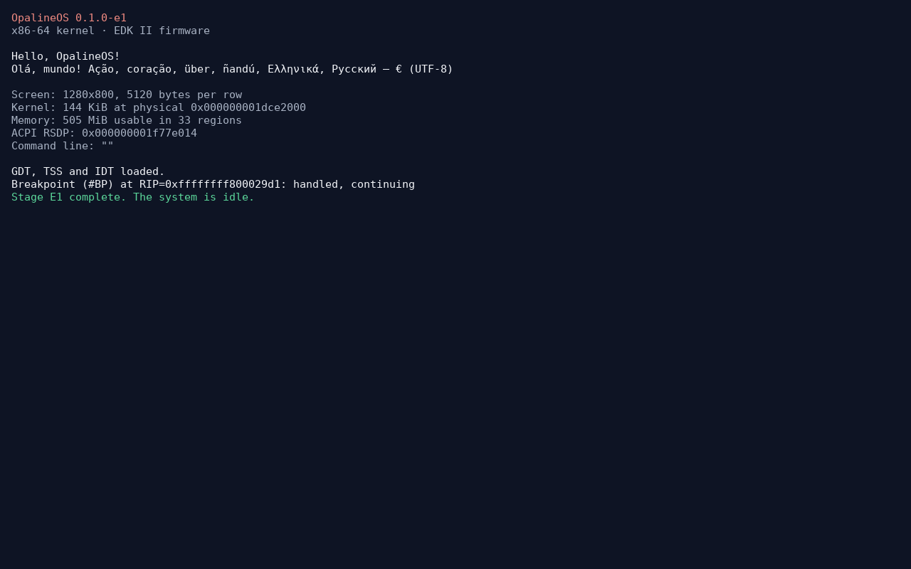

# OpalineOS

A light, fast and modern operating system with its own kernel, where **Python is at the center**:
the desktop and the apps are written in Python (official CPython) using `opaline-vitrum`, the
system's GUI toolkit.

> **Status:** stage **E1** — UEFI bootloader, 64-bit higher-half kernel, UTF-8 console on the
> framebuffer and serial port, GDT/TSS/IDT and exception diagnostics.


> The full plan is in [`project.md`](project.md) (in Portuguese) and the toolkit API in
> [`opaline-vitrum.md`](opaline-vitrum.md).

## Requirements (Windows)

- Python 3
- LLVM (`clang`, `lld-link`): `winget install LLVM.LLVM`
- NASM (from the next stages on): `winget install NASM.NASM`
- QEMU (includes the OVMF UEFI firmware): `winget install SoftwareFreedomConservancy.QEMU`
- VirtualBox (optional, second test machine)

## Build, run and test

```
python tools/build.py              # builds build/opaline.img (add --clean for a fresh build)
python tools/vm.py run             # boots in QEMU (window)
python tools/vm.py run vbox        # boots in VirtualBox (creates the "OpalineOS" VM the first time)
python tools/vm.py test            # automated boot and exception tests in QEMU and VirtualBox
python tools/vm.py run --cmdline test=pagefault   # see the panic screen
```

The test prints `TEST_OK` / `TEST_FAILED` per emulator and exits with a non-zero code on failure.

## License

**GPL-3.0-or-later** for the system and **LGPL-3.0-or-later** for the libraries that apps import
(`opaline.vitrum`, `opaline.system`, `opaline.i18n`), so apps for OpalineOS can use any license.
See [`LICENSING.md`](LICENSING.md), [`COPYING`](COPYING) and [`COPYING.LESSER`](COPYING.LESSER).
